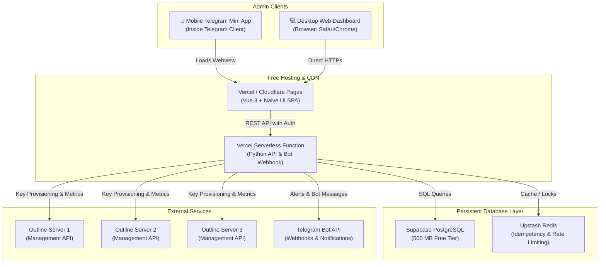

# Outline Key Bot — Web & Telegram Mini App Dashboard Architecture

## 1. Executive Summary
This document specifies the technical architecture for the **Outline Key Bot Control Center** — a hybrid **Web Dashboard** and **Telegram Mini App (TMA)** designed for managing Outline VPN access keys, user balances, slip verifications, and multi-server traffic monitoring.

The system is designed with a **100% Free Tier ($0/month)** hosting model, utilizing modern technologies to deliver an enterprise-grade dark-themed operational interface modeled after high-performance control centers.

---

## 2. High-Level System Architecture

---

## 3. Technology Stack

| Layer | Chosen Technology | Rationale & Free Tier Guarantee |
|---|---|---|
| **Frontend Framework** | **Vue 3 (Composition API) + Vite** | Lightweight, high-performance, fast reactivity, seamless component reusability. |
| **UI Component Library** | **Naive UI (`naive-ui`)** | Extremely rich dark-theme support, TypeScript-native, clean enterprise aesthetics (matching OpsTranslate look-and-feel). |
| **Icons & Charts** | **Iconify / Vicons + Chart.js / ECharts** | Sleek telemetry charts (bandwidth usage over time) and sharp SVG icons. |
| **State Management** | **Pinia** | Clean global store for auth, servers, keys, and pending slips. |
| **Backend API** | **Python (FastAPI or Flask REST)** | Shares data models and Outline API logic with the existing Telegram Bot codebase. |
| **Database** | **Supabase PostgreSQL** | **100% Free** (500 MB capacity, relational integrity for users, orders, keys, audit logs, auto-generated REST API). |
| **Caching & Sync** | **Upstash Redis** | **100% Free** (10,000 commands/day, used for ephemeral locks, rate limits, and OCR deduplication). |
| **Hosting (Frontend)** | **Vercel** or **Cloudflare Pages** | **100% Free** with automatic GitHub CI/CD deployments and global edge CDN. |
| **Hosting (Backend)** | **Vercel Serverless** | **100% Free** under Hobby Plan (100k invocations/month). |

---

## 4. Key Differentiators & Features

1. **Dual Experience (Hybrid Web + Telegram Mini App)**:
   - **On Desktop**: Renders as a full-featured admin portal with collapsible sidebar navigation, live charts, and wide tables.
   - **Inside Telegram Mobile**: Renders as a native mobile app via Telegram's WebApp SDK with haptic feedback, dark mode synchronization, and touch-optimized controls.
2. **Zero-Click Authentication (Telegram InitData)**:
   - When opened inside Telegram, the app validates `window.Telegram.WebApp.initData` cryptographically using HMAC-SHA256 with `TELEGRAM_TOKEN`.
   - Admin access is granted instantly without requiring username/password entry.
   - For standalone desktop browsers, a fallback Admin Access Secret/PIN is provided.
3. **Multi-Server Telemetry**:
   - Visual health and real-time bandwidth consumption across Outline Server 1, Server 2, and Server 3.
4. **Slip Verification Lightbox**:
   - Visual queue for submitted payment screenshots with zoom inspection, OCR comparison, and 1-tap Approve/Reject triggers.
