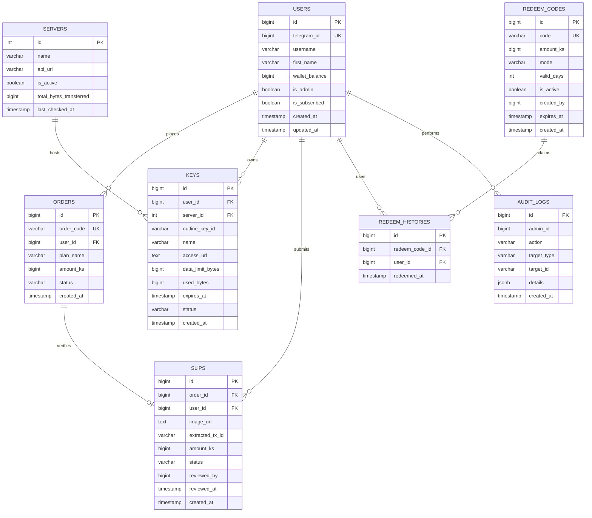

# Supabase PostgreSQL Database Schema

## 1. Overview
This schema replaces ephemeral JSON flat files with a structured PostgreSQL database hosted on **Supabase Free Tier (500 MB)**. It enforces referential integrity, indexes for fast search, and audit trails for all administrative actions.

---

## 2. Entity Relationship Diagram (ERD)



---

## 3. SQL Migration Script (DDL)

```sql
-- Enable UUID extension if needed
CREATE EXTENSION IF NOT EXISTS "uuid-ossp";

-- 1. Users Table
CREATE TABLE IF NOT EXISTS users (
    id BIGSERIAL PRIMARY KEY,
    telegram_id BIGINT UNIQUE NOT NULL,
    username VARCHAR(255),
    first_name VARCHAR(255),
    wallet_balance BIGINT DEFAULT 0,
    is_admin BOOLEAN DEFAULT FALSE,
    is_subscribed BOOLEAN DEFAULT FALSE,
    created_at TIMESTAMPTZ DEFAULT NOW(),
    updated_at TIMESTAMPTZ DEFAULT NOW()
);
CREATE INDEX IF NOT EXISTS idx_users_telegram_id ON users(telegram_id);

-- 2. Outline Servers Table
CREATE TABLE IF NOT EXISTS servers (
    id SERIAL PRIMARY KEY,
    name VARCHAR(100) NOT NULL,
    api_url TEXT NOT NULL,
    is_active BOOLEAN DEFAULT TRUE,
    total_bytes_transferred BIGINT DEFAULT 0,
    last_checked_at TIMESTAMPTZ DEFAULT NOW()
);

-- 3. Keys Table
CREATE TABLE IF NOT EXISTS keys (
    id BIGSERIAL PRIMARY KEY,
    user_id BIGINT REFERENCES users(id) ON DELETE SET NULL,
    server_id INT REFERENCES servers(id) ON DELETE RESTRICT,
    outline_key_id VARCHAR(50) NOT NULL,
    name VARCHAR(255) NOT NULL,
    access_url TEXT NOT NULL,
    data_limit_bytes BIGINT DEFAULT 0, -- 0 = Unlimited
    used_bytes BIGINT DEFAULT 0,
    expires_at TIMESTAMPTZ,
    status VARCHAR(50) DEFAULT 'ACTIVE', -- ACTIVE, EXPIRED, REVOKED
    created_at TIMESTAMPTZ DEFAULT NOW()
);
CREATE INDEX IF NOT EXISTS idx_keys_outline_key_id ON keys(outline_key_id);
CREATE INDEX IF NOT EXISTS idx_keys_user_id ON keys(user_id);
CREATE INDEX IF NOT EXISTS idx_keys_status ON keys(status);

-- 4. Orders Table
CREATE TABLE IF NOT EXISTS orders (
    id BIGSERIAL PRIMARY KEY,
    order_code VARCHAR(100) UNIQUE NOT NULL,
    user_id BIGINT REFERENCES users(id) ON DELETE CASCADE,
    plan_name VARCHAR(100) NOT NULL,
    amount_ks BIGINT NOT NULL,
    status VARCHAR(50) DEFAULT 'COMPLETED', -- COMPLETED, PENDING, FAILED
    created_at TIMESTAMPTZ DEFAULT NOW()
);
CREATE INDEX IF NOT EXISTS idx_orders_order_code ON orders(order_code);

-- 5. Slips Table (Payment Verification Queue)
CREATE TABLE IF NOT EXISTS slips (
    id BIGSERIAL PRIMARY KEY,
    order_id BIGINT REFERENCES orders(id) ON DELETE SET NULL,
    user_id BIGINT REFERENCES users(id) ON DELETE CASCADE,
    image_url TEXT NOT NULL,
    extracted_tx_id VARCHAR(100),
    amount_ks BIGINT NOT NULL,
    status VARCHAR(50) DEFAULT 'PENDING', -- PENDING, APPROVED, REJECTED
    reviewed_by BIGINT,
    reviewed_at TIMESTAMPTZ,
    created_at TIMESTAMPTZ DEFAULT NOW()
);
CREATE INDEX IF NOT EXISTS idx_slips_status ON slips(status);

-- 6. Redeem Codes Table
CREATE TABLE IF NOT EXISTS redeem_codes (
    id BIGSERIAL PRIMARY KEY,
    code VARCHAR(100) UNIQUE NOT NULL,
    amount_ks BIGINT NOT NULL,
    mode VARCHAR(50) DEFAULT 'single', -- single, shared
    valid_days INT DEFAULT 30,
    is_active BOOLEAN DEFAULT TRUE,
    created_by BIGINT,
    expires_at TIMESTAMPTZ,
    created_at TIMESTAMPTZ DEFAULT NOW()
);
CREATE INDEX IF NOT EXISTS idx_redeem_codes_code ON redeem_codes(code);

-- 7. Redeem Histories Table
CREATE TABLE IF NOT EXISTS redeem_histories (
    id BIGSERIAL PRIMARY KEY,
    redeem_code_id BIGINT REFERENCES redeem_codes(id) ON DELETE CASCADE,
    user_id BIGINT REFERENCES users(id) ON DELETE CASCADE,
    redeemed_at TIMESTAMPTZ DEFAULT NOW(),
    UNIQUE(redeem_code_id, user_id)
);

-- 8. Audit Logs Table (Administrative Actions)
CREATE TABLE IF NOT EXISTS audit_logs (
    id BIGSERIAL PRIMARY KEY,
    admin_id BIGINT NOT NULL,
    action VARCHAR(100) NOT NULL, -- e.g. "KEY_DELETE", "SLIP_APPROVE", "BALANCE_ADJUST"
    target_type VARCHAR(50),
    target_id VARCHAR(100),
    details JSONB,
    created_at TIMESTAMPTZ DEFAULT NOW()
);
CREATE INDEX IF NOT EXISTS idx_audit_logs_action ON audit_logs(action);
CREATE INDEX IF NOT EXISTS idx_audit_logs_created_at ON audit_logs(created_at DESC);
```
